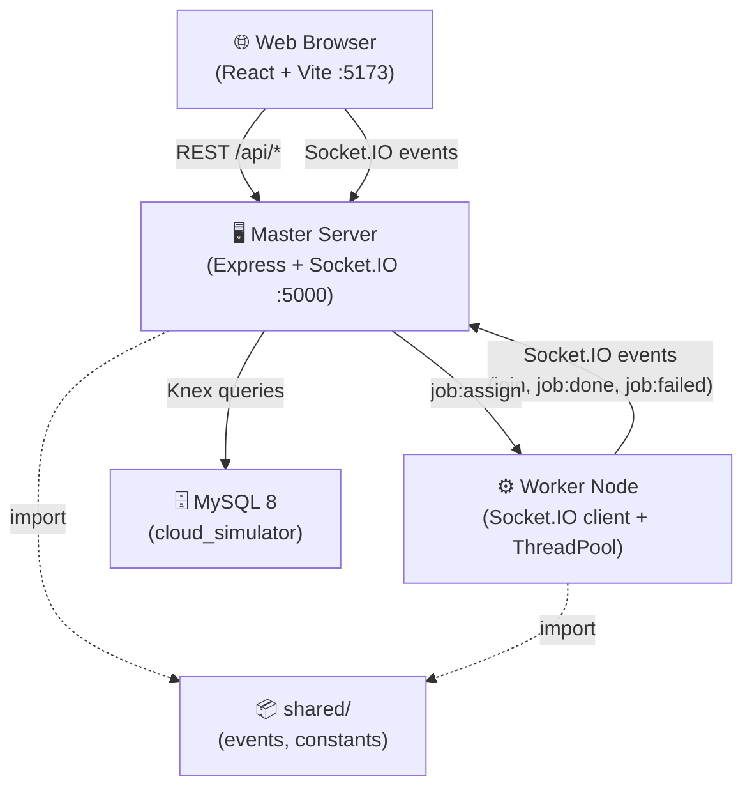
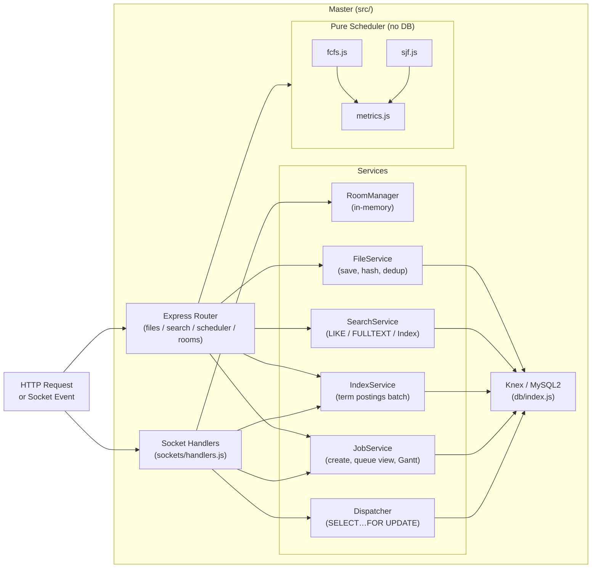
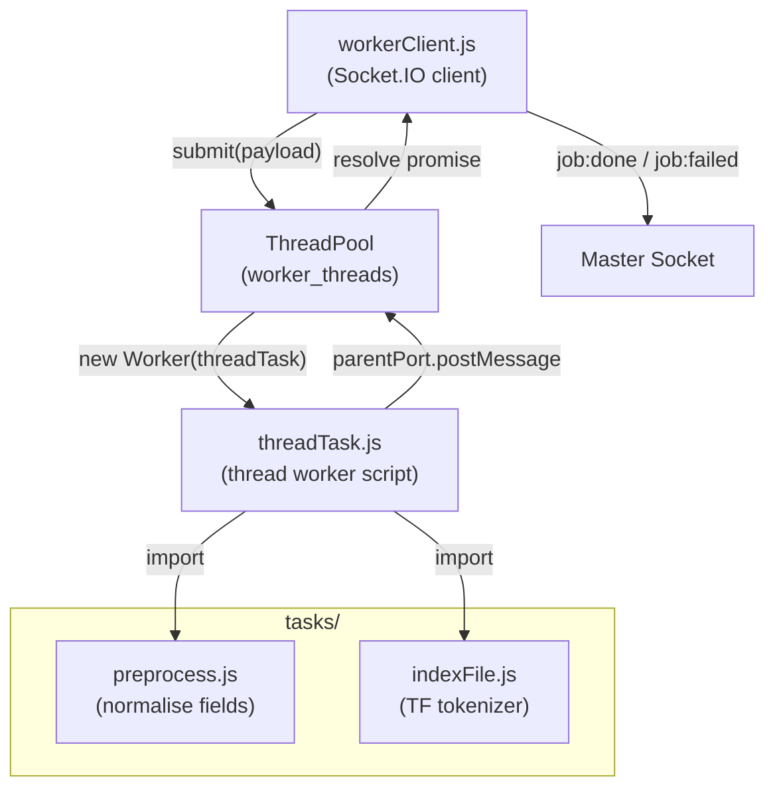
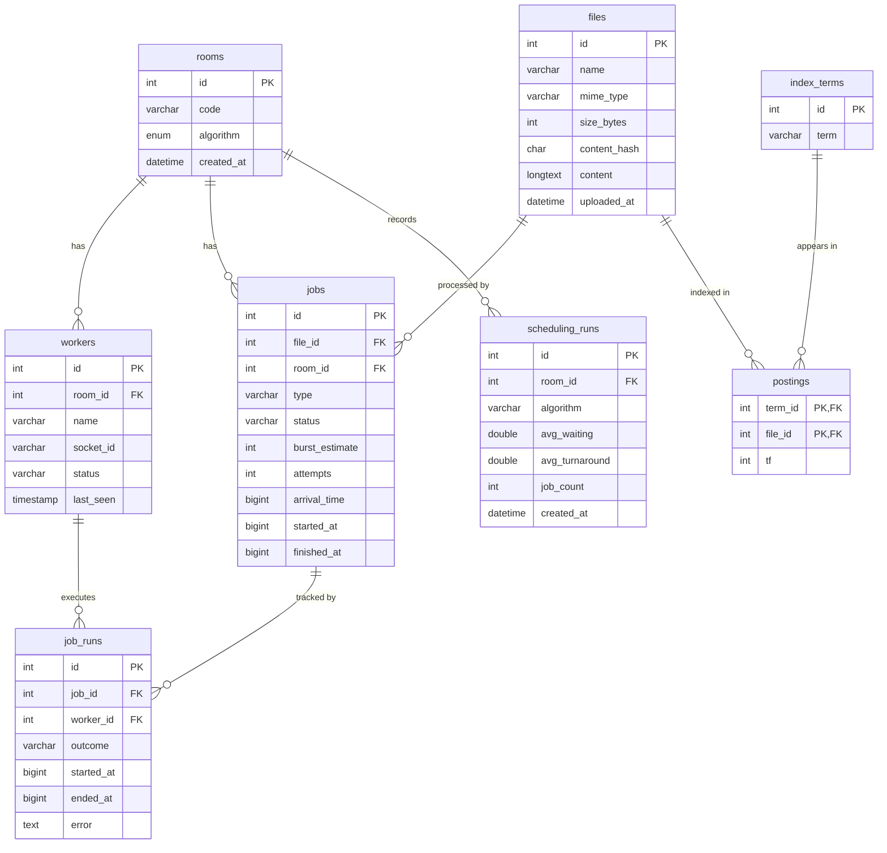
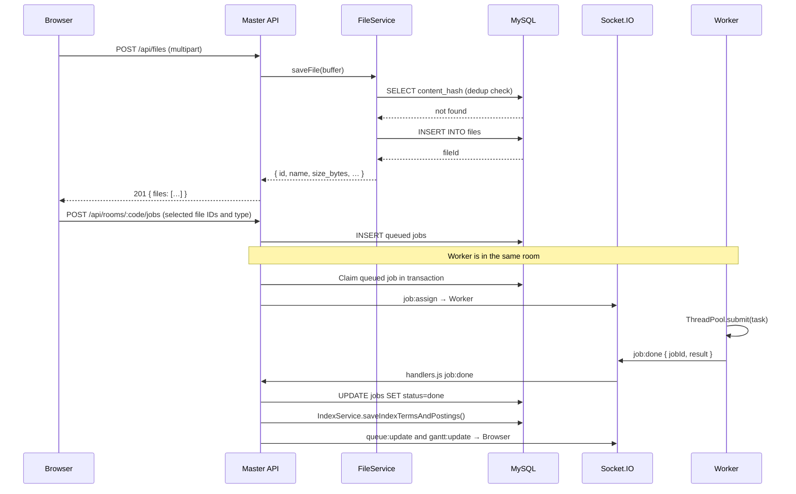

# Architecture — Distributed Cloud Resource Simulator

## Component Overview

Browser clients emit the shared `room:subscribe` event after entering or creating a room. The master joins the Socket.IO room and sends the current workers, job queue, and Gantt snapshot before subsequent live updates.

## Internal Master Subsystems

## Worker Internals

## Database Schema

## Request Flow: File Upload → Index Job

